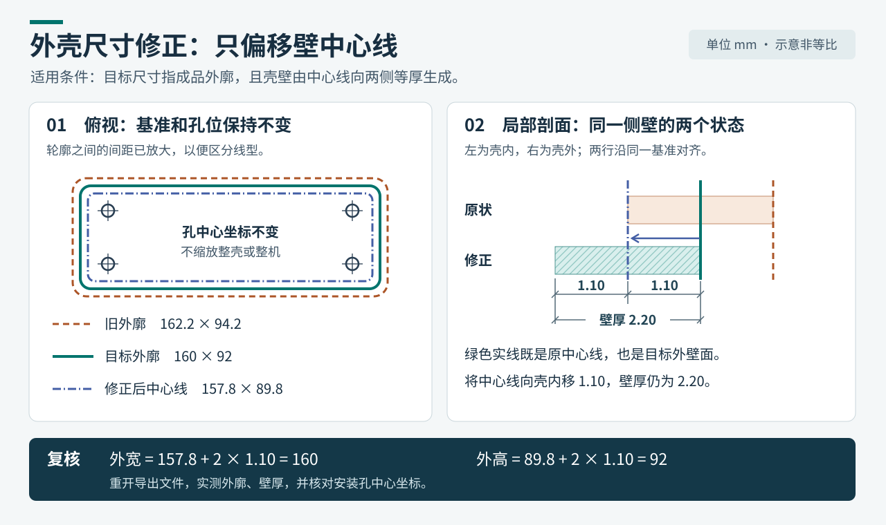

# StopKey R1：把 4.2 英寸墨水屏、面板键和 USB-C 装进同一副壳

这个案例有两个不同的交付对象：给板厂的是一块 **32 × 54 mm 的载板**，给装配者看的是一台 **160 × 92 × 33.2 mm 的带屏终端**（不含按钮帽、螺钉头和脚）。面板键触发软件任务撤回，不是切断设备电源的工业安全急停。以下是嘉立创专业版 **3.2.91 半离线**一次实际导出的结果，尺寸除另注外均为 mm。

## 哪些件真的焊在板上？

| 对象 | 装法 | 在嘉立创里怎样表示 |
|---|---|---|
| U1，标准 Seeed XIAO ESP32S3 | 模块贴装，USB-C 在模块上，插头从壳顶边进入 | 生产 PCB 位号；采用相符的厂家 STEP，核对金属口而非只看板子长方形 |
| J1、J2、R1、R2、C1、C2 | J1 是屏用 8 针排针；J2 是按键用 2 针排针；另有两只电阻和两只电容 | 连同 U1 共 **7 个板上位号**。J1/J2 为通孔件，并非七件全部贴片 |
| 微雪 13353，4.2 英寸黑白 V2 SPI 模块 | 屏模块经线束接 J1，压片固定驱动板；不靠玻璃承力 | 在装配参考页按安装位置放外形参考。不作为第八个载板焊接件，不假设屏有可用的角安装孔 |
| C&K AP4D300TZBE，面板键 | 螺母和垫圈固定；两个无极性的常开触点分别接 J2.1（GPIO6）和 J2.2（GND），不要向接口送电 | 装配参考件；看见按钮帽不等于看见背后的焊耳 |

生产页 `PCB1` 保留原有板框和网络；另设“装配参考－禁止投板”，复用 7 个真实位号的位置，增放 2 个板外参考件，不加电气焊盘、不进 PCB BOM。要看组好的机器，打开装配页的 **视图 → 3D 外壳预览**，关掉后盖的眼睛；要出 Gerber、钻孔、贴装坐标，请回到生产页。

## 三次导出，比预览图更有说服力

| 阶段 | 实际导出看到了什么 | 当时能下的结论 |
|---|---|---|
| 初版壳 | 能回读外壳对象；STL 里却只有 12 根柱子，没有两片壳壁 | 失败。在同版 GUI 做一个能导出的最小壳，再比对实体字段和侧槽引用。 |
| 形成两片壳后 | 已能看到开孔，长宽却为 **162.2003 × 94.2002**，各大约 2.2 | 开孔能看见，外廓仍不合格。2.2 恰是壁厚，检查边框究竟代表壁中心还是外表面。 |
| 只修中心线后 | 同一装配坐标下，最终两件 STL 联合外廓 **160.0003 × 92.0002 × 33.2001** | 相对 160 × 92 × 33.2，在示例逐轴容差 0.01 内。此容差比较的是两份数字几何，不是打印机精度。 |



本例壁厚 2.2，中心线向里、向外各生出 1.10。保持板孔、按钮、屏窗和 USB 的共同基准不动，只把**外壳中心线**改成 **157.8 × 89.8**，路径圆角半径由 4.5 减至 3.4。这样左右、上下各补回两个半壁厚，外尺寸就对了。不要缩放整机来消掉这 2.2；那会连孔距都改错。

## 自己重跑外廓检查，不需要嘉立创客户端

仓库附[这次真正导出的前后壳 STL 压缩包](../assets/stopkey-r1-native-shell.zip)，约 2.45 MiB，内有两件、共用原点。它们是**原生装配参考件，不是推荐直接切片的打印母版**；不包含元器件模型。下载或克隆仓库后，在仓库根目录运行（Python 3.10+；Windows 也可用 `py`）。解压请选择新的空目录：

```powershell
python -m zipfile -e assets/stopkey-r1-native-shell.zip stopkey-native-demo
python scripts/workbench.py shell-size stopkey-native-demo/3DShell_StopKeyFinal_T.stl stopkey-native-demo/3DShell_StopKeyFinal_B.stl --unit mm --expected-mm 160 92 33.2 --tolerance-mm 0.01
```

看 JSON 的 `union.size_mm` 和退出码：**0** 表示这一项尺寸通过，**1** 表示某轴不同，**2** 表示输入不合要求。可把命令的 Z 目标改成 `36` 做反例；用 5.0 加 31.0001 会高估装配高度，因为两件沿 Z 在合盖位置重叠。导出包 SHA-256：`4af2f2849c69724a65ed49e03f3061d0f8c01e77c5f7231c3e23de33acaefe09`。

## 外廓对了，还要过哪些检查？

下面是原工程的验收记录。公开包里的两件 STL 可以离线复测外壳；它不含元件 OBJ、生产 PCB 或打印母版。`shell-size` 也没有执行下表中的射线、孔径和电气检查。

| 问题 | 本例如何验证 | 结果和边界 |
|---|---|---|
| 会遮屏、挡 USB 或让按键打转吗？ | 目标屏窗 **91.6 × 70**，有效显示区 **84.8 × 63.6**；USB 顶边开口 **18 × 12.2**。正面按键中心距左 23、距底 19，单 D 孔 **Ø13.70**、平边到对侧圆弧 **13.00**。在导出壳网格上选通孔点和相邻实壁点。 | **19 个射线抽样点通过，不是有 19 个孔。** 屏的有效区偏移还需真屏点亮四边确认，线缆插头塑胶外壳也要试。 |
| 哪些孔要比较？ | 载板自身是 4 个 **Ø2.4 NPTH**，中心距 **26 × 48**；壳内的 4 个载板柱导孔名义 Ø1.65，后盖另有 4 个间隙孔名义 Ø2.90。 | 后两组共 **8 个截面**通过：前者约 Ø1.648，后者约 Ø2.896–2.898。导孔、通孔、间隙孔功能不同，不能统一改为 Ø2.4。 |
| 预览里的器件都是真的吗？ | 禁用生成替代模型，独立检查原生元件 OBJ 中的坐标、网格和特征，并核对最终修壳前后 OBJ/MTL 成员的哈希。 | **7 个板上件和 2 个板外件的存在性通过**，生产 PCB 的 9 个网络已核对、严格 DRC 回报空违规列表。它们不是同一种检查。 |
| 按钮与后盖之间有足够焊线空间吗？ | 把原生 OBJ 和详细几何对照：屏被简化为几个平面，按钮末段少约 **4.5 mm 焊耳**。 | **保真度未通过，实际线束净空待实装**。详细模型可看焊耳，整机 GLB 也没有真实线束；不能用任一预览替代焊线、插线和试合盖。 |
| 已经打印并装好了吗？ | 项目另备独立打印母版，6 种 STL 已软件切片，4 份 3MF 已回读。 | **未做实物打印、插拔、按压力或玻璃受力试验**。先打 USB 和按钮试片，配手头的插头与按钮，再做整壳。 |

**如何在公开 STL 中辨认一个真开口：** 不要把壳件自动居中，沿用导出的 PCB 世界坐标（不是上面的面板正视尺寸）。在前壳上，从 `(-108.15, 7.35, -1)` 沿 +Z 看，屏窗左沿内侧的前壁应是空的；把起点横移到 `(-108.50, 7.35, -1)`，方向不变，就应在距起点约 **1.0 至 3.2 mm** 处遇到边框实体。这两个点只差 0.35 mm，却能区分“正确开窗”和“整片前壁消失”。远处若命中后盖，不算前窗堵塞。检查 USB 改由侧面向内取样：本例从 `(15.97, 58, 10.855)` 沿 −Y，靠近入口应无料；上沿外的 `(16.01, 58, 16.45)` 则应有料。

应用到另一块板时，通用的是**分清生产件与装配件、保留共同基准、用导出物验证**。这里的图层号、半壁厚修正、部件尺寸和孔径都不是通用设计规则。[回到通用操作指南](native-assembly.md)
